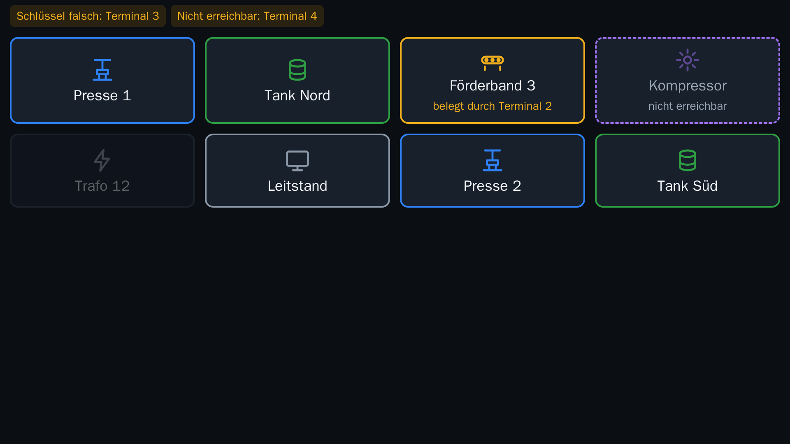

# hmi-kiosk

**Deutsch** · [English](#english)

Kiosk-System für HMI-Terminals auf dem **Raspberry Pi 5**. Ein Touchbildschirm zeigt Kacheln für die Bedienpanels (HMIs) einer Anlage. Ein Tipp auf eine Kachel öffnet das HMI über VNC (Remmina oder TigerVNC) oder als Webseite (zum Beispiel ein Grafana-Dashboard). Mehrere Terminals stimmen sich direkt miteinander ab, wer ein HMI gerade belegt. Eingerichtet wird alles über eine Admin-Seite im Browser.



## Funktionen

- **Kachelseite** mit Symbolen, Farben und Erreichbarkeitsanzeige (Ping, Port oder aus)
- **VNC-Kacheln** über Remmina oder TigerVNC, mit Vorabprüfung der Anmeldung (schützt vor der RealVNC-Sperre nach Fehlversuchen)
- **Web-Kacheln** für Grafana-Dashboards und HMI-Webseiten; Navigation nur auf demselben Server, Anmeldung bleibt gespeichert
- **Mehrere Terminals**: Übernahme, Sperre und Vorrang direkt zwischen den Geräten, ohne zentralen Server
- **Daueranzeige** eines HMIs, auf Wunsch ohne Leiste, mit Rückkehr bei Inaktivität
- **Admin-Seite** über HTTPS im Netz (`https://<IP>:8443`) und am Terminal selbst über das Zahnrad, mit Bildschirmtastatur
- **Netzwerk**: feste IP-Adresse mit 2-Minuten-Rückfallfrist, WLAN und Bluetooth abschaltbar, NTP
- **Betriebssicherheit**: schreibgeschütztes System (Overlay), eigene Datenpartition, signierte Programm-Updates mit automatischem Rückfall, Sicherung des ganzen Datenträgers auf USB, Wartungsmodus
- Läuft von **SD-Karte, NVMe-SSD oder USB-Laufwerk**

## Download

Die fertigen Dateien liegen unter [**Releases**](../../releases):

| Datei | Zweck |
|---|---|
| `hmi-kiosk-<Version>.img.xz` | SD-Abbild für den Raspberry Pi 5 (empfohlen) |
| `hmi-kiosk-bundle-<Version>-trixie-arm64.tar.gz` | Offline-Bundle zur Installation auf einem vorhandenen Raspberry Pi OS / Debian Trixie |
| `*.sha256` | Prüfsummen |

Prüfsumme kontrollieren (Linux/macOS: `sha256sum -c <Datei>.sha256`, Windows PowerShell: `Get-FileHash <Datei>`).

## Installation A: SD-Abbild (empfohlen)

**Voraussetzungen:** Raspberry Pi 5, Touchbildschirm, Netzwerkkabel, SD-Karte (ab 16 GB) oder SSD/USB-Laufwerk, [Raspberry Pi Imager](https://www.raspberrypi.com/software/) auf dem PC.

1. Raspberry Pi Imager starten.
2. Gerät „Raspberry Pi 5“ wählen. Unter **Betriebssystem** ganz unten **„Eigenes Image“** wählen und `hmi-kiosk-<Version>.img.xz` auswählen.
3. Als Speicher die SD-Karte (oder SSD/USB-Laufwerk) wählen.
4. Bei der Frage nach der **OS-Anpassung** mit **„Nein“** antworten. Hostname, Benutzer, WLAN und SSH dürfen nicht im Imager gesetzt werden: Das Abbild richtet sich selbst ein.
5. Schreiben und prüfen lassen, Karte in den Pi stecken.
6. Pi mit Netzwerkkabel, Bildschirm und Strom verbinden.
7. **Erster Start:** Das Gerät legt die Datenpartition an, schaltet den Schreibschutz ein und startet **einmal von selbst neu**. Das dauert einige Minuten (bis etwa 10). Nicht ausschalten. Danach erscheint die (noch leere) Kachelseite.

**Von SSD oder USB starten:** Einmalig die Startreihenfolge des Pi 5 auf „NVMe/USB Boot“ stellen (Imager → „Misc utility images“ → „Bootloader (Pi 5 family)“ → „NVMe/USB Boot“ auf eine freie SD-Karte schreiben und einmal damit starten, oder `sudo raspi-config` → Advanced Options → Boot Order).

Klappt der erste Start nicht: Karte in einen PC stecken und auf der kleinen Boot-Partition `hmi-kiosk-firstboot.log` lesen.

## Installation B: Bundle auf vorhandenem System

Für **Raspberry Pi OS oder Debian Trixie** (arm64). Es gibt dabei keinen Schreibschutz und keine eigene Datenpartition; das Abbild bleibt der empfohlene Weg.

```bash
sha256sum -c hmi-kiosk-bundle-<Version>-trixie-arm64.tar.gz.sha256
sudo tar xzf hmi-kiosk-bundle-<Version>-trixie-arm64.tar.gz -C /opt
cd /opt/hmi-kiosk-bundle-<Version>-trixie-arm64
sudo ./install.sh
```

- **Raspberry Pi OS mit Desktop:** `sudo ./install.sh --disable-desktop` und danach `sudo reboot`. Der Kiosk braucht den Bildschirm allein; das Skript bricht sonst ab, ohne etwas zu ändern.
- Mit Internet am Gerät ist `--online` besser (Pakete aus den Paketquellen statt aus dem Bundle).
- Weitere Optionen: `--data-dir ORDNER` (Standard `/var/lib/hmi-kiosk`), `--no-start`, `--force-downgrade`.
- Den entpackten Ordner unter `/opt` aufheben. Das Skript ist wiederholbar; eine vorhandene Konfiguration bleibt erhalten.

## Einrichtung

1. IP-Adresse des Terminals im Router/DHCP-Server suchen (Hostname `hmi-kiosk`). Eine DHCP-Reservierung je Terminal wird empfohlen.
2. Im Browser `https://<IP>:8443` öffnen. Die Zertifikatswarnung ist erwartet (selbst erzeugtes Zertifikat): „Erweitert“ → „Weiter zu <IP>“.
3. **Sofort ein Admin-Passwort festlegen** (mindestens 10 Zeichen). Es gibt kein Standardpasswort; bis dahin kann jeder im Netz die Ersteinrichtung ausführen.
4. In dieser Reihenfolge einrichten: **HMIs** (VNC oder Webseite, mit „Testen“) → **Client** → **Kiosk** (Layout, Daueranzeige) → **Terminals** (weitere Terminals und gemeinsamer Schlüssel) → **Netzwerk** (feste IP, WLAN/Bluetooth aus) → **System** (Zeit, Sicherung).
5. Am Terminal führt das **Zahnrad** oben rechts zur Admin-Seite (Anmeldung nötig, Rückkehr nach 5 Minuten ohne Eingabe).

**Grafana als Web-Kachel:** `?kiosk` an die Dashboard-Adresse hängen, um die Grafana-Menüs auszublenden. Anonymer Zugang (`auth.anonymous`) oder Anmeldung in der Kachel sind beide möglich. HTTPS nur mit vertrauenswürdigem Zertifikat; Weiterleitungen auf andere Anmeldeserver (SSO) sind gesperrt.

## Aktualisieren

- **Programm-Update** (signiertes `.pkg`): Admin-Seite → System → „Update hochladen“. Meldet sich die neue Version nicht innerhalb von 60 Sekunden gesund, schaltet das Gerät von selbst zurück.
- **Updates per Klick:** Das Terminal prüft täglich die GitHub-Releases und zeigt neue Versionen unter System → „Updates“ an (installiert nie von selbst); „Herunterladen und installieren“ prüft Signatur und Systemstand wie beim Hochladen. Vorabversionen sind ab Werk einbezogen, abschaltbar. Proxy und Release-Ablauf: `docs/betrieb.md`, Abschnitt 2.
- Ein Programm-Update ersetzt **nur** das Kiosk-Programm. Helfer, Systempakete und Einstellungen unter `/etc` (zum Beispiel die Chromium-Sperrliste) kommen nur mit einem **neuen Abbild** bzw. mit erneutem `install.sh` aus dem neuen Bundle.
- **Ab 0.1.6 nötig:** Wer von 0.1.5 oder älter kommt, muss das 0.1.6-Abbild neu schreiben (vorher unter System „Konfiguration sichern“, danach wieder einspielen) bzw. `install.sh` aus dem 0.1.6-Bundle ausführen. Sonst meldet das Zahnrad „This page is blocked“, und Bildschirmtastatur sowie Web-Kacheln fehlen.

## Dokumentation

- [Inbetriebnahme](docs/inbetriebnahme.md): Abbild bauen, Karte schreiben, erster Start, Einrichtung, Selbst- und Dauerprüfung, mehrere Terminals, install.sh
- [Betrieb](docs/betrieb.md): Update, Rückfall, Sicherung, Wartung, feste IP, Web-Kacheln, Fehlersuche
- [Entscheidungen](docs/entscheidungen.md): Begründungen der technischen Entscheidungen

## Für Entwickler

Go muss lokal nicht installiert sein: `scripts/dgo` führt das Go-Werkzeug im Container `golang:1.24-bookworm` aus. Nötig sind Docker und eine Bash (unter Windows Git Bash).

```bash
scripts/dgo test -race ./...                          # alle Tests
scripts/dgo vet ./...                                 # statische Prüfung
scripts/dgo test -tags integration ./test/integration/  # Integrationstest mit zwei Diensten
bash test/install/run.sh                              # install.sh im frischen debian:trixie-Container

scripts/dgo run ./cmd/hmi-kiosk-pack keygen -out .secrets   # Release-Schlüssel (einmalig)
make release VERSION=1.0.0                            # Programme mit Version nach dist/
VERSION=1.0.0 bash packaging/build-image.sh           # SD-Abbild mit pi-gen (rund 25 Minuten)
bash packaging/bundle.sh --version 1.0.0 --arch arm64 # Offline-Bundle
```

**Der private Release-Schlüssel `.secrets/release.key` gehört nie ins Repository.** Wer ihn hat, kann Updates für alle Terminals signieren.

| Pfad | Inhalt |
|---|---|
| `cmd/hmi-kiosk` | Kiosk-Dienst; Unterbefehle `selftest` und `soak` |
| `cmd/hmi-kiosk-helper` | root-Helfer mit fester Befehlsliste (Zeit, Netz, Sicherung, Update-Aktivierung) und Update-Wächter |
| `cmd/hmi-kiosk-pack` | Release-Schlüssel erzeugen, Update-Pakete signieren |
| `internal/app` | Verdrahtung, Selbst- und Dauerprüfung |
| `internal/config`, `internal/secrets` | Konfiguration und verschlüsselte Geheimnisse |
| `internal/session`, `internal/client`, `internal/browser`, `internal/keyboard` | Sitzungsablauf, VNC- und Web-Clients, Chromium, Bildschirmtastatur |
| `internal/coord` | Abstimmung zwischen Terminals |
| `internal/rfb` | VNC-Protokoll für Vorabprüfung und Test-Server |
| `internal/web` | Kachelseite und Admin-Seite |
| `internal/helper`, `internal/helperapi` | Helfer und sein Socket-Protokoll |
| `internal/update`, `internal/release` | Update-Pakete, Aktivierung, Rückfall |
| `packaging/` | Abbild-Bau, `bundle.sh`, `install.sh`, Systemdateien |
| `test/` | Integrationstest, Test von `install.sh` |

---

<a id="english"></a>

# hmi-kiosk (English)

[Deutsch](#hmi-kiosk) · **English**

Kiosk system for HMI terminals on the **Raspberry Pi 5**. A touchscreen shows tiles for the operator panels (HMIs) of a plant. Tapping a tile opens the HMI via VNC (Remmina or TigerVNC) or as a web page (for example a Grafana dashboard). Several terminals coordinate directly with each other about who is currently using an HMI. Everything is configured through an admin page in the browser.

> The user interface and the detailed manuals in `docs/` are in German.

## Features

- **Tile page** with icons, colours and reachability indicator (ping, port or off)
- **VNC tiles** via Remmina or TigerVNC, with an authentication pre-check (prevents the RealVNC lockout after failed attempts)
- **Web tiles** for Grafana dashboards and HMI web pages; navigation restricted to the same server, logins are kept
- **Multiple terminals**: takeover, lock and priority negotiated directly between devices, no central server
- **Permanent display** of one HMI, optionally without the bar, with return on inactivity
- **Admin page** over HTTPS on the network (`https://<IP>:8443`) and on the terminal itself via the gear icon, with on-screen keyboard
- **Network**: static IP with a 2-minute rollback window, Wi-Fi and Bluetooth can be disabled, NTP
- **Robustness**: read-only system (overlay), separate data partition, signed program updates with automatic rollback, full-disk backup to USB, maintenance mode
- Runs from **SD card, NVMe SSD or USB drive**

## Download

Ready-made files are under [**Releases**](../../releases):

| File | Purpose |
|---|---|
| `hmi-kiosk-<version>.img.xz` | SD image for the Raspberry Pi 5 (recommended) |
| `hmi-kiosk-bundle-<version>-trixie-arm64.tar.gz` | Offline bundle for installing on an existing Raspberry Pi OS / Debian Trixie |
| `*.sha256` | Checksums |

Verify the checksum (Linux/macOS: `sha256sum -c <file>.sha256`, Windows PowerShell: `Get-FileHash <file>`).

## Installation A: SD image (recommended)

**Requirements:** Raspberry Pi 5, touchscreen, Ethernet cable, SD card (16 GB or more) or SSD/USB drive, [Raspberry Pi Imager](https://www.raspberrypi.com/software/) on a PC.

1. Start Raspberry Pi Imager.
2. Choose device "Raspberry Pi 5". Under **Operating System** scroll down to **"Use custom"** and select `hmi-kiosk-<version>.img.xz`.
3. Choose the SD card (or SSD/USB drive) as storage.
4. When asked about **OS customisation**, answer **"No"**. Do not set hostname, user, Wi-Fi or SSH in the Imager: the image configures itself.
5. Let it write and verify, then insert the card into the Pi.
6. Connect the Pi to Ethernet, the screen and power.
7. **First boot:** the device creates the data partition, enables write protection and **reboots once by itself**. This takes a few minutes (up to about 10). Do not switch it off. Afterwards the (still empty) tile page appears.

**Booting from SSD or USB:** set the Pi 5 boot order to "NVMe/USB Boot" once (Imager → "Misc utility images" → "Bootloader (Pi 5 family)" → "NVMe/USB Boot" written to a spare SD card and booted once, or `sudo raspi-config` → Advanced Options → Boot Order).

If the first boot fails: put the card into a PC and read `hmi-kiosk-firstboot.log` on the small boot partition.

## Installation B: bundle on an existing system

For **Raspberry Pi OS or Debian Trixie** (arm64). There is no write protection and no separate data partition; the image remains the recommended way.

```bash
sha256sum -c hmi-kiosk-bundle-<version>-trixie-arm64.tar.gz.sha256
sudo tar xzf hmi-kiosk-bundle-<version>-trixie-arm64.tar.gz -C /opt
cd /opt/hmi-kiosk-bundle-<version>-trixie-arm64
sudo ./install.sh
```

- **Raspberry Pi OS with desktop:** `sudo ./install.sh --disable-desktop`, then `sudo reboot`. The kiosk needs the screen to itself; otherwise the script aborts without changing anything.
- With internet access on the device, `--online` is better (packages from the system's repositories instead of the bundle).
- More options: `--data-dir DIR` (default `/var/lib/hmi-kiosk`), `--no-start`, `--force-downgrade`.
- Keep the extracted folder under `/opt`. The script can be re-run; an existing configuration is preserved.

## Setup

1. Find the terminal's IP address in your router/DHCP server (hostname `hmi-kiosk`). A DHCP reservation per terminal is recommended.
2. Open `https://<IP>:8443` in a browser. The certificate warning is expected (self-generated certificate): "Advanced" → "Proceed to <IP>".
3. **Set an admin password immediately** (at least 10 characters). There is no default password; until it is set, anyone on the network can run the initial setup.
4. Configure in this order: **HMIs** (VNC or web page, use "Testen") → **Client** → **Kiosk** (layout, permanent display) → **Terminals** (other terminals and shared key) → **Netzwerk** (static IP, Wi-Fi/Bluetooth off) → **System** (time, backup).
5. On the terminal, the **gear icon** in the top right opens the admin page (login required, returns to the tiles after 5 minutes without input).

**Grafana as a web tile:** append `?kiosk` to the dashboard URL to hide Grafana's menus. Anonymous access (`auth.anonymous`) or logging in inside the tile both work. HTTPS only with a trusted certificate; redirects to other login servers (SSO) are blocked.

## Updating

- **Program update** (signed `.pkg`): admin page → System → "Update hochladen". If the new version does not report healthy within 60 seconds, the device rolls back by itself.
- **One-click updates:** the terminal checks the GitHub releases daily and lists new versions under System → "Updates" (it never installs by itself); "Herunterladen und installieren" verifies signature and system level exactly like an upload. Pre-releases are included by default and can be switched off. Proxy and release process: `docs/betrieb.md`, section 2.
- A program update replaces **only** the kiosk program. The helper, system packages and settings under `/etc` (for example the Chromium block list) only change with a **new image** or by re-running `install.sh` from the new bundle.
- **Required for 0.1.6:** coming from 0.1.5 or older, re-flash the 0.1.6 image (back up the configuration under System first and restore it afterwards) or run `install.sh` from the 0.1.6 bundle. Otherwise the gear icon shows "This page is blocked", and the on-screen keyboard and web tiles are missing.

## Documentation (German)

- [Inbetriebnahme](docs/inbetriebnahme.md) – building the image, flashing, first boot, setup, self-test and soak test, multiple terminals, install.sh
- [Betrieb](docs/betrieb.md) – updates, rollback, backup, maintenance, static IP, web tiles, troubleshooting
- [Entscheidungen](docs/entscheidungen.md) – rationale for technical decisions

## For developers

Go does not need to be installed locally: `scripts/dgo` runs the Go toolchain in the `golang:1.24-bookworm` container. You need Docker and Bash (Git Bash on Windows). See the commands and repository layout in the [German section](#für-entwickler).

**Never commit the private release key `.secrets/release.key`.** Whoever has it can sign updates for every terminal.
